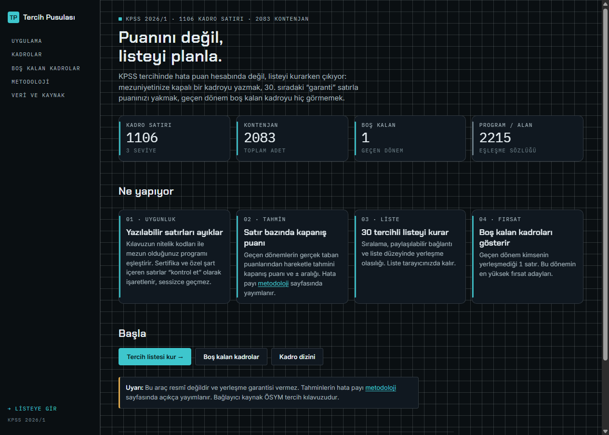
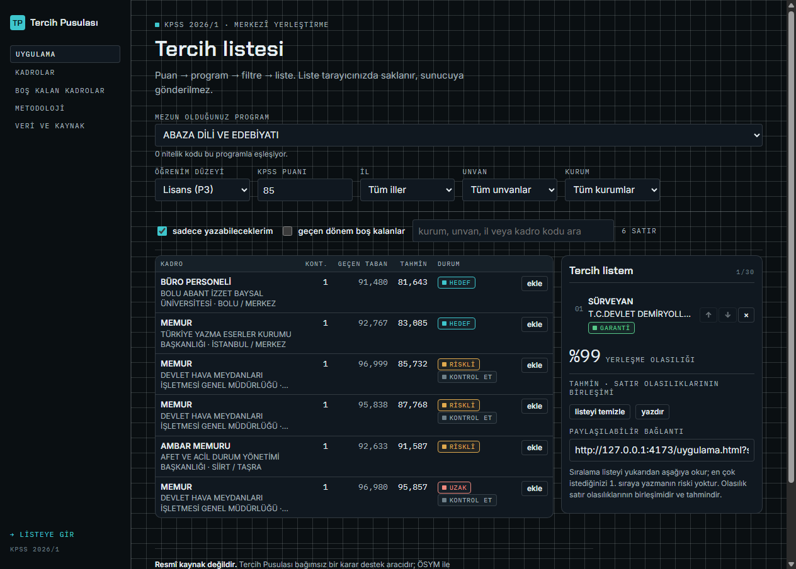

# Tercih Pusulası

**KPSS tercih karar destek aracı** — resmî olmayan, tamamen statik, bağımlılıksız.
ÖSYM merkezî yerleştirmesinde "hangi kadro bana uygun, kapanış puanı ne olur, bu tercih gerçekçi mi"
sorusunu ölçülebilir biçimde yanıtlar.

`node ≥ 22` · `0 runtime dependency` · `139 static page` · `38 unit test` · `6 data gate (A–F)` · `32 browser check` · `tercihpusula.com`

> **Resmî kaynak değildir.** Bağlayıcı olan, ilgili dönemin ÖSYM tercih kılavuzu ve
> [ais.osym.gov.tr](https://ais.osym.gov.tr)'dir. Tahminler geçmiş yerleşmelere dayanır,
> yerleşme garantisi vermez.

---

## Why

~250.000 aday her dönem 30 tercih doldurur. Karar için gereken üç bilgi — *bu kadroya yazabilir miyim*,
*geçen dönem kaçla kapandı*, *bu dönem ne olur* — üç ayrı PDF'te dağınık durur ve hiçbiri
"ne kadar yanılabileceğini" söylemez. Bu proje üçünü tek ekranda birleştirir ve **hatasını yayımlar**.

## What it does

| # | Yetenek | Nasıl |
|---|---|---|
| 01 | Dönem anlık görüntüsü | Her dönemin resmî sonuç belgesi indirilir, hash'lenir, değişmez JSON olarak saklanır |
| 02 | Yazılabilirlik grafiği | Kılavuzun nitelik kodlarından **mezuniyet programı → yazılabilir kadro** eşlemesi |
| 03 | Tahmini kapanış puanı | Üç çapalı geçmiş modeli + ölçülmüş σ aralığı; hata payı `/metodoloji` sayfasında |
| 04 | Tercih listesi | 30 slotlu liste kurucu, risk bantları, paylaşılabilir bağlantı, PWA |

Sertifika, ehliyet veya "Bakınız Başvurma Özel Şartları" içeren nitelik kodları **sessizce geçmez**;
satır "kontrol et" etiketiyle gösterilir (2026/1'de 1.106 satırın 649'u, %58,7).

## Look

| Landing | Preference builder |
|---|---|
|  |  |


<sub>Screenshots are produced by the browser gate: `npm run smoke && npm run shots:docs`.</sub>

## Architecture


| Stage | Dosya | Çıktı |
|---|---|---|
| fetch | `pipeline/run.mjs fetch` | `data/raw/<round>/` (gitignored) + sha256 manifest |
| parse | `parse-results`, `parse-summary` | `data/rounds/<round>/{lisans,onlisans,ortaogretim,summary}.json` |
| guide | `parse-guide`, `eligibility` | `guide.json` — program, nitelik sözlüğü, kadro tablosu |
| measure | `backtest`, `predict` | `backtest.json` (σ, MAE), `predictions.json` |
| publish | `web/build.mjs` | `dist/` — statik HTML + JSON, çalışma anında dış servis yok |

## Data model

Bir kadro satırı, tek doğruluk kaynağı olarak ÖSYM kadro kodunu taşır:

```json
{
  "kod": "301013986",
  "kurum": "ADIYAMAN İL ÖZEL İDARESİ",
  "il": "ADIYAMAN",
  "tes": "MERKEZ",
  "unvan": "MÜHENDİS",
  "knt": 1,
  "nit": [4685],
  "taban": 80.85842,
  "bos": false,
  "tahmin": { "puan": 83.81037, "alt": 76.65037, "ust": 90.97037, "source": "unvan_il" },
  "kaynak": "sonuc"
}
```

`data/raw/<round>/` — indirilen baytlar (gitignore) · `data/rounds/<round>/` — commit'lenmiş anlık
görüntü · `data/reference/` — küratörlü yedek haritalar (kılavuz belge haritası, il listesi).

## Accuracy — published, not promised

Tahmin, geçmiş dönemden üretilip sonraki dönemde sınanır: rolling origin, 2 dönem çifti × 3 düzey = 6 karşılaştırma, 2.878 satır.

| Düzey | Ortalama hata (MAE) | Aralık (σ) | Aralık isabeti | Karşılaştırılan |
|---|---|---|---|---|
| Lisans (P3) | **3,94** puan | ±7,16 | %47,5 | 1.523 |
| Ön lisans (P93) | **5,57** puan | ±10,06 | %24,6 | 971 |
| Ortaöğretim (P94) | **4,24** puan | ±9,03 | %48,4 | 384 |

Çapa sırası tahmin değil, ölçüm sonucudur — "aynı kadro kodu" çapası (%14,9 kullanım) 8,58 puan
hatayla, "aynı unvan + il" çapası (%80,0 kullanım) 4,48 puan hatayla çalışıyor.

## Verification — three layers, all green

| Katman | Ne ölçer | Komut | Sonuç |
|---|---|---|---|
| Unit | parser, gate, eligibility, predictor | `npm test` | 38/38 |
| Data gates | A resmî toplam · B şema · C dönem farkı · D bağımsız kaynak · E tablo↔sonuç · F alan doğruluğu | `node pipeline/run.mjs gate` | 9/9 · 9/9 · 9/9 · 9/9 · 3/3 · 3/3 |
| Browser | gerçek sayfa: tablo, süzgeç, liste, paylaşım, XSS, başlıklar | `npm run smoke` | 32/32 |

Alan doğruluğu (kadro tablosu ↔ sonuç belgeleri): **il %99,6–100 · kontenjan %100 · unvan %88–100 ·
kurum %30–61** (PDF'te taşan hücreler kurum metnini bozar; satır kimliği her zaman kadro kodudur).

Veri iddiaları PDF'ten bağımsız çıkarımla da sınanır: `pdftotext -raw` ile 1.106 satırın tamamı
yeniden okundu, kontenjan / yerleşen / taban puan alanlarında **0 fark**.

## Security posture

- **Sıfır runtime bağımlılığı** — tedarik zinciri yüzeyi yok; `pdftotext` argüman dizisiyle çağrılır, shell yok.
- `dist/_headers`: CSP (`script-src 'self'`, `frame-ancestors 'none'`, `object-src 'none'`), HSTS,
  `nosniff`, `X-Frame-Options`, `Referrer-Policy`, `Permissions-Policy`, COOP.
- Paylaşım bağlantısı (`?l=`) yalnız **bilinen kadro kodlarını** kabul eder; `innerHTML`'e giren her
  değer kaçırılır (DOM XSS kapatıldı, smoke'ta regresyon kapısı var).
- Inline `<script>` / inline handler / üçüncü taraf istek yok → CSP sıkı kalabiliyor.
- Kişisel veri sunucuya gitmez: puan ve liste yalnız `localStorage` + URL'de.

## Quick start

```bash
node -v                      # >= 22 gerekir
node pipeline/run.mjs all    # fetch → parse → guide → gate → backtest → predict
npm run build                # dist/ üret
node web/serve.mjs 4174      # http://127.0.0.1:4174 önizleme
npm run gate                 # test + tüm hat + build + tarayıcı kontrolü
```

`npm install` yok — kurulacak paket yok. PDF metni için `pdftotext` gerekir (`PDFTOTEXT_BIN` ile yol
verilebilir; bu makinede yalnız Git'in MSYS2 ağacında bulunuyor).

## Commands

| Komut | İş |
|---|---|
| `node pipeline/run.mjs fetch [--all] [--only=2026/2]` | belgeleri indir + hash'le |
| `node pipeline/run.mjs parse` | sonuç PDF → normalize JSON |
| `node pipeline/run.mjs guide` | kılavuz → nitelik sözlüğü + yazılabilirlik grafiği |
| `node pipeline/run.mjs gate` | A–F veri kapıları (biri düşerse yayın durur) |
| `node pipeline/run.mjs backtest` | rolling-origin geri test → σ, MAE |
| `node pipeline/run.mjs predict` | yeni dönem tahminleri + bantlar |
| `npm run build` · `npm run smoke` · `npm test` | site · tarayıcı · birim testleri |
| `npm run shots:docs` | `.shots/` ekran görüntülerini README'ye kopyala |

## Deploy

Statik çıktı, edge'e hazır: `npx wrangler pages deploy dist --project-name tercihpusula`
(`dist/_headers` güvenlik başlıklarını taşır). Yayın öncesi kapı: `npm run gate` yeşil olmalı.

## Launch day — KPSS 2026/2

Tercih penceresi **17–24 Aralık 2026**. Kılavuz yayımlandığı gün izlenecek sıra `RUNBOOK.md` §3–5'te:
`fetch --only=2026/2` → `parse` → `guide` → `gate` → `backtest` → `predict` → `build` → deploy.

## Limits & non-goals

- Kalabalık simülasyonu (aday havuzu) **yok**; tercih davranışı kayması modele girmez.
- Kontenjan şoku (1 → 20) yalnız küçük bir düzeltmeyle taşınır.
- Hesap, giriş, ödeme yok — 2026/2 dönemi ücretsiz.
- Resmî yerleştirme aracı değildir; hukuki/akademik danışmanlık vermez.

## Attribution

Veri ÖSYM'nin kamuya açık belgelerinden türetilmiştir. Çapraz doğrulama için kpssden.com açık veri
seti (CC BY 4.0) kullanılmıştır: *"KPSSDEN (kpssden.com), ÖSYM verilerinden derlenmiştir."*
Kod lisansı: TBD.

---
---

# Türkçe

**Tercih Pusulası**, ÖSYM KPSS merkezî yerleştirmesi için resmî olmayan bir karar destek aracıdır.
"Bu kadroya yazabilir miyim, geçen dönem kaçla kapandı, bu dönem ne olur" sorusunu tek ekranda
yanıtlar ve **ne kadar yanılabileceğini yayımlar**. ÖSYM ile bağlantılı değildir; bağlayıcı kaynak
her zaman güncel tercih kılavuzu ve `ais.osym.gov.tr`'dir.

## Görünüm

| Açılış | Tercih listesi |
|---|---|
|  |  |

## Ne yapar

- **Dönem anlık görüntüsü:** her dönemin resmî sonuç belgesi indirilir, hash'lenir, değişmez JSON olarak saklanır (şu an 2025/1, 2025/2, 2026/1 — 4.305 kadro satırı).
- **Yazılabilirlik grafiği:** mezun olunan program → nitelik kodu → kadro satırı. Sertifika ve özel şart kodları otomatik geçmez, "kontrol et" ile işaretlenir (2026/1'de satırların %58,7'si).
- **Tahmini kapanış puanı:** üç çapalı geçmiş modeli, düzey başına ölçülmüş σ aralığıyla; hata payı `/metodoloji` sayfasında açıkça yayımlanır.
- **Tercih listesi:** 30 slotlu kurucu, risk bantları (garanti / hedef / riskli / uzak), paylaşılabilir bağlantı, PWA.
- **Kadro dizini:** 52 unvan ve 81 il için ayrı sayfa; kontenjan, taban puan aralığı, geçen dönem boş kalan kadrolar.

## Ölçülen doğruluk

| Düzey | Ortalama hata | Aralık | Aralık isabeti |
|---|---|---|---|
| Lisans (P3) | 3,94 puan | ±7,16 | %47,5 |
| Ön lisans (P93) | 5,57 puan | ±10,06 | %24,6 |
| Ortaöğretim (P94) | 4,24 puan | ±9,03 | %48,4 |

Kadro tablosu ↔ sonuç belgesi eşleşmesi: il %99,6–100 · kontenjan %100 · unvan %88–100 · kurum %30–61.
Tüm 1.106 satır ayrıca `pdftotext -raw` ile bağımsız olarak yeniden okundu: kontenjan, yerleşen ve
taban puan alanlarında fark yok.

## Doğrulama

`npm run gate` üç katmanı birlikte koşar: **38 birim testi**, **6 veri kapısı (A–F)**, **32 tarayıcı
kontrolü**. Kapılardan biri düşerse site yayımlanmaz.

## Hızlı başlangıç

```bash
node pipeline/run.mjs all    # indir → ayrıştır → kılavuz → kapı → geri test → tahmin
npm run build                # dist/ (139 statik sayfa)
node web/serve.mjs 4174      # önizleme
npm run gate                 # her şey, sırayla
```

`npm install` yok; kurulacak paket yok. PDF metni için `pdftotext` gerekir (`PDFTOTEXT_BIN` ile yol verilebilir).

## Güvenlik

Sıfır runtime bağımlılığı; `dist/_headers` ile CSP, HSTS, `nosniff`, `X-Frame-Options`,
`Referrer-Policy`, `Permissions-Policy`, COOP. Paylaşım bağlantısı yalnız bilinen kadro kodlarını
kabul eder, DOM'a giren her değer kaçırılır. Puan ve liste sunucuya gitmez: yalnız tarayıcıda
(`localStorage`) ve paylaşım URL'inde tutulur.

## Yayın

`npx wrangler pages deploy dist --project-name tercihpusula` — statik çıktı, edge'e hazır.
KPSS 2026/2 tercih penceresi **17–24 Aralık 2026**; yayın günü adımları `RUNBOOK.md` §3–5'te,
plan ve ölçüm günlüğü `plani.md` dosyasında.

## Sınırlar

Kalabalık (aday havuzu) simülasyonu yok; kontenjan şoku yalnız küçük düzeltmeyle taşınır; hesap/giriş
yok (2026/2 ücretsiz); resmî yerleştirme aracı değildir.

## Atıf

Veri ÖSYM'nin kamuya açık belgelerinden türetilmiştir. Çapraz doğrulama için kpssden.com açık veri
seti (CC BY 4.0) kullanılmıştır: *"KPSSDEN (kpssden.com), ÖSYM verilerinden derlenmiştir."*
