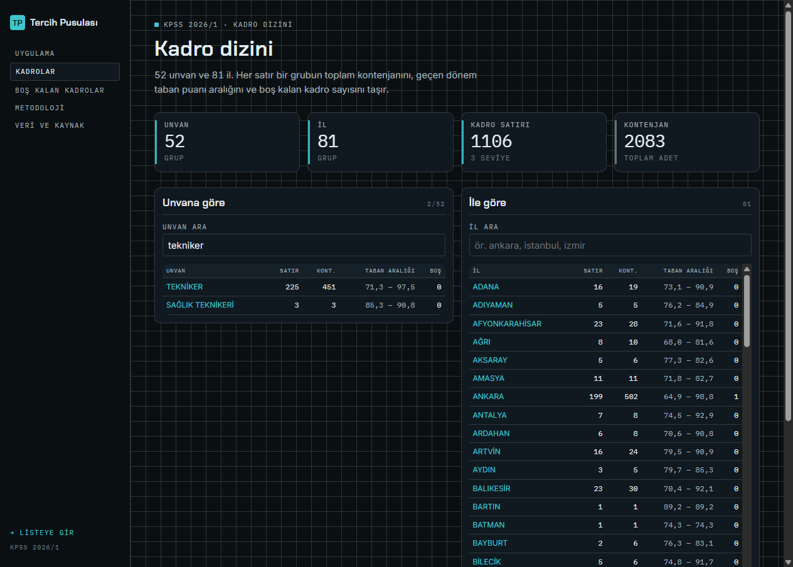
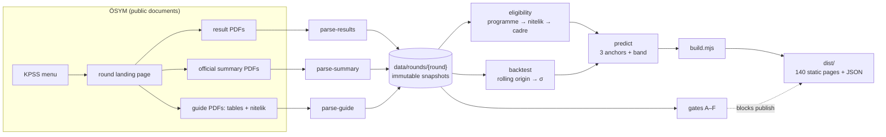
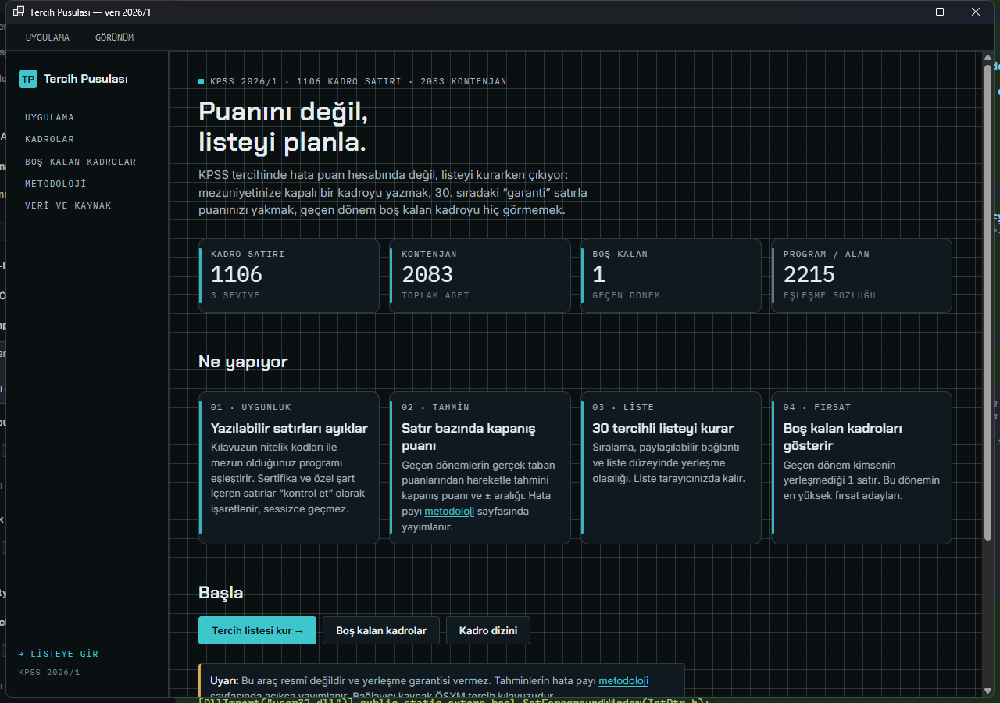
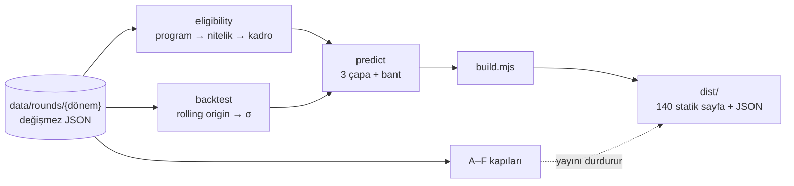

# Tercih Pusulası

**KPSS preference-list decision support** — unofficial, fully static, zero dependencies.

Every KPSS term around 250,000 candidates fill 30 preferences. The three facts needed to decide —
*can I apply to this cadre*, *what did it close at last term*, *what will it close at this term* —
sit in three separate PDFs, and none of them tells you **how wrong it can be**. This project puts all
three on one screen and publishes its own error rate.

[](package.json)
[](package.json)
[](web/build.mjs)
[](tests)
[](https://github.com/bahattinercan/tercihpusula/releases/latest)
[](https://bahattinercan.github.io/tercihpusula/)

> **Not an official source.** The binding documents are the ÖSYM guide for the term and
> [ais.osym.gov.tr](https://ais.osym.gov.tr). Predictions come from past placements and guarantee
> nothing. This project is not affiliated with ÖSYM.

### Download for Windows

**[TercihPusula-win-x64-2026-1.zip](https://github.com/bahattinercan/tercihpusula/releases/latest)**
· 1.75 MB · unzip, double-click `TercihPusula.exe`. No installer, no registry, no admin rights, no
network.

### Live site

**https://bahattinercan.github.io/tercihpusula/** — the whole app runs in the browser; the Turkish
product page is at [`/tanitim.html`](https://bahattinercan.github.io/tercihpusula/tanitim.html).
Deployed by `.github/workflows/pages.yml` on every push to `master`; the build runs under a path
prefix (`TP_BASE`) because GitHub Pages serves a project site from `/tercihpusula/`.

**Contents** · [Download](#download-for-windows) · [Screens](#screens) · [What it does](#what-it-does) · [How it works](#how-it-works) ·
[Accuracy](#accuracy--published-not-promised) · [Data model](#data-model) ·
[Verification](#verification--four-layers) · [Quick start](#quick-start) · [Commands](#commands) ·
[Windows app](#windows-app) · [Security](#security-posture) · [Limits](#limits--non-goals) ·
[Layout](#repository-layout) · [Türkçe](#türkçe)

---

## Screens

| Landing | Preference builder |
|---|---|
|  |  |



<sub>Produced by the browser gate: `npm run smoke && npm run shots:docs`.</sub>

## What it does

| # | Capability | How |
|---|---|---|
| 01 | Term snapshot | Each term's official result document is downloaded, hashed and stored as immutable JSON (2025/1, 2025/2, 2026/1 — 4,305 cadre rows) |
| 02 | Eligibility graph | Guide qualification codes mapped to **graduated programme → cadre you may apply to** |
| 03 | Predicted closing score | Three-anchor historical model with a measured σ band; the error margin is published on `/metodoloji` |
| 04 | Preference list | 30-slot builder, risk bands (safe / target / risky / far), shareable link, installable PWA |
| 05 | Cadre index | A page per unvan (52) and per il (81) with quota, last-round range and cadres left empty |
| 06 | Product page | `/tanitim.html` — what it is, measured accuracy, screenshots, Windows download and FAQ, all in Turkish |

Qualification codes that hide a certificate, a licence or "see the special conditions" are **never
skipped silently** — the row is flagged "kontrol et" (2026/1: 649 of 1,106 rows, 58.7 %).

## How it works



| Stage | File | Output |
|---|---|---|
| fetch | `pipeline/run.mjs fetch` | `data/raw/<round>/` (gitignored) + sha256 manifest |
| parse | `parse-results`, `parse-summary` | `data/rounds/<round>/{lisans,onlisans,ortaogretim,summary}.json` |
| guide | `parse-guide`, `eligibility` | `guide.json` — programmes, qualification dictionary, cadre table |
| measure | `backtest`, `predict` | `backtest.json` (σ, MAE), `predictions.json` |
| publish | `web/build.mjs` | `dist/` — static HTML + JSON, no runtime service |

## Accuracy — published, not promised

The model is fitted on one past term and tested on the next: rolling origin, 2 term pairs × 3 levels
= 6 comparisons, 2,878 rows.

| Level | Mean absolute error | Band (σ) | Band hit rate | Rows compared |
|---|---|---|---|---|
| Lisans (P3) | **3.94** points | ±7.16 | 47.5 % | 1,523 |
| Ön lisans (P93) | **5.57** points | ±10.06 | 24.6 % | 971 |
| Ortaöğretim (P94) | **4.24** points | ±9.03 | 48.4 % | 384 |

The anchor order is a measurement, not a choice: the "same cadre code" anchor (used 14.9 % of the
time) is off by 8.58 points, while "same unvan + il" (used 80.0 %) is off by 4.48 points.

Field accuracy (cadre table ↔ result documents):

| Field | Match |
|---|---|
| il | 99.6–100 % |
| kontenjan (quota) | 100 % |
| unvan | 88–100 % |
| kurum | 30–61 % |

Kurum is low because overflowing cells break institution names in the PDF; the row identity is
always the cadre code. Independently, all 1,106 rows were re-read with `pdftotext -raw`: **no
difference** in quota, placed and base-score fields.

## Data model

One cadre row carries the ÖSYM cadre code as its single source of truth:

```json
{
  "kod": "301013986",
  "kurum": "ADIYAMAN İL ÖZEL İDARESİ",
  "il": "ADIYAMAN",
  "tes": "MERKEZ",
  "unvan": "MÜHENDİS",
  "knt": 1,
  "nit": [4685],
  "taban": 80.85842,
  "bos": false,
  "tahmin": { "puan": 83.81037, "alt": 76.65037, "ust": 90.97037, "source": "unvan_il" },
  "kaynak": "sonuc"
}
```

`data/raw/<round>/` — downloaded bytes (gitignored) · `data/rounds/<round>/` — committed snapshot ·
`data/reference/` — curated fallback maps (guide document map, il list).

## Verification — four layers

| Layer | What it measures | Command | Result |
|---|---|---|---|
| Unit | parsers, gates, eligibility, predictor, Turkish folding, empty-state index, past-term history | `npm test` | 49/49 |
| Data gates | A official totals · B schema · C term delta · D independent source · E table↔result · F field accuracy | `node pipeline/run.mjs gate` | 9/9 · 9/9 · 9/9 · 9/9 · 3/3 · 3/3 |
| Browser | the real page: table, filters, list, sharing, XSS, headers, promo page, accent-free search, past-term drill-down | `npm run smoke` | 51/51 |
| Desktop | the packaged exe: local origin, embedded data, list persistence, blocked external navigation, print bridge | `npm run desktop:check` | 14/14 |

If any gate falls, the site is not published: `npm run gate` chains all three web layers,
`npm run gate:desktop` adds the desktop build.

## Quick start

```bash
node -v                      # 22 or newer
node pipeline/run.mjs all    # fetch → parse → guide → gate → backtest → predict
npm run build                # dist/
node web/serve.mjs 4174      # http://127.0.0.1:4174
npm run gate                 # tests + full pipeline + build + browser checks
```

There is no `npm install` — there is nothing to install. PDF text needs `pdftotext`
(override the path with `PDFTOTEXT_BIN`; on this machine only the copy in Git's MSYS2 tree exists).

## Commands

| Command | Does |
|---|---|
| `node pipeline/run.mjs fetch [--all] [--only=2026/2]` | download and hash the documents |
| `node pipeline/run.mjs parse` | result PDF → normalised JSON |
| `node pipeline/run.mjs guide` | guide → qualification dictionary + eligibility graph |
| `node pipeline/run.mjs gate` | data gates A–F (a failure blocks publishing) |
| `node pipeline/run.mjs backtest` | rolling-origin backtest → σ, MAE |
| `node pipeline/run.mjs predict` | predictions for the new term + bands |
| `npm run build` · `npm run smoke` · `npm test` | site · browser · unit tests |
| `npm run shots:docs` | copy `.shots/` screenshots into the README |
| `npm run desktop:build` · `desktop:check` · `gate:desktop` | package the Windows app · run its gate · web gate + both |

## Windows app

**[Download the latest release](https://github.com/bahattinercan/tercihpusula/releases/latest)** —
`TercihPusula-win-x64-2026-1.zip`

| | |
|---|---|
| File | `TercihPusula-win-x64-2026-1.zip` — 1.75 MB (contains `TercihPusula.exe`, 2.65 MB, plus a README.txt) |
| Install | none: unzip anywhere (a path with spaces or Turkish characters is fine) and run the exe |
| Requires | Windows 10/11 x64 + WebView2 Runtime (preinstalled on Windows 11) |
| Data | 2026/1 term — 1,106 cadre rows, 140 pages |
| sha256 | `6e820591bc30a8979185d28c4ad780096e741730d64a563bf684690986be54ce` |
| Signature | **unsigned** — Smart App Control may block the first launch; choose "Run anyway" |
| Version | 0.3.0 ([all releases](https://github.com/bahattinercan/tercihpusula/releases)) |

`TercihPusula.exe` — portable, no installer, no network. It serves itself from a loopback listener.

```bash
npm run desktop:build     # dist.zip → icon → dotnet publish → build/desktop + portable zip
npm run desktop:check     # 14-check desktop gate (exit 0/1)
npm run gate:desktop      # web gate + desktop build + desktop check
```

| | |
|---|---|
| Runtime | .NET 11 WinForms + WebView2, single file (2.65 MB) |
| Content | `dist/` embedded in the exe, extracted to `%LOCALAPPDATA%\TercihPusula\app\<sha8>\` |
| Origin | `http://127.0.0.1:47821` — loopback only, nothing reachable from another machine |
| Data | 2026/1 snapshot; a new term means a new exe or a `data-override\` folder beside the exe |
| Guards | external navigation blocked, downloads cancelled, permissions denied, devtools off in release |
| Speed | first paint ~780 ms, 20–292 ms per page |



<sub>Captured by launching the packaged exe and grabbing its window (`PrintWindow`) — no browser chrome, no address bar.</sub>

The preference list lives in the WebView2 profile, so it survives app updates and follows the Windows
user, not the folder. Why the shell serves over loopback instead of WebView2's virtual host (a
measured ~2 s per request), plus troubleshooting and rollback: [`docs/desktop-app.md`](docs/desktop-app.md).

## Deploy

Two targets, both from the same `dist/`:

| Target | Command | Notes |
|---|---|---|
| GitHub Pages (live now) | push to `master` → `.github/workflows/pages.yml` | serves from `/tercihpusula/`, so the workflow builds with `TP_BASE` and `TP_META_CSP` (Pages ignores `dist/_headers`) |
| Cloudflare Pages | `npx wrangler pages deploy dist --project-name tercihpusula` | root origin, `dist/_headers` applies the full CSP including `frame-ancestors` |

`npm run gate` must be green first. The 2026/2 preference window is **17–24 December 2026**;
launch-day order is in `RUNBOOK.md` §3–5.

## Security posture

- **Zero runtime dependencies** — no supply-chain surface; `pdftotext` is called with an argument
  array, never through a shell.
- `dist/_headers`: CSP (`script-src 'self'`, `frame-ancestors 'none'`, `object-src 'none'`), HSTS,
  `nosniff`, `X-Frame-Options`, `Referrer-Policy`, `Permissions-Policy`, COOP.
- The share link (`?l=`) accepts **known cadre codes only**; everything reaching the DOM is escaped
  (DOM XSS closed, with a regression gate in the smoke suite).
- No inline `<script>`, no inline handlers, no third-party requests — which is what keeps the CSP
  strict.
- Personal data never leaves the machine: score and list live in `localStorage` and the URL only.
- The desktop shell adds: foreign navigation blocked, downloads cancelled, permissions denied,
  devtools closed in release builds.

## Limits & non-goals

- No crowd simulation (candidate pool) — preference-behaviour shift is not modelled.
- Quota shocks (1 → 20) are carried only by a small correction.
- No accounts, no login, no payments; the 2026/2 term is free.
- Not an official placement tool; it gives no legal or academic advice.

## Repository layout

```
pipeline/        fetch → parse → guide → gate → backtest → predict (node, no dependencies)
  lib/           shared parsing, validation and formatting helpers
web/             build.mjs (static generator), serve.mjs, smoke.mjs, _headers, assets/
tests/           49 unit tests (node:test)
desktop/         .NET 11 WinForms + WebView2 shell for Windows
scripts/         desktop build/check, icon generator
data/rounds/     committed immutable snapshots per term
data/reference/  curated fallback maps
docs/            desktop-app.md (ops), desktop-app-plan.md (decisions), screenshots
dist/            generated site (gitignored)
build/           packaged exe + zip (gitignored)
```

## Attribution

Data is derived from ÖSYM's public documents. The kpssden.com open dataset (CC BY 4.0) was used for
cross-checking: *"KPSSDEN (kpssden.com), ÖSYM verilerinden derlenmiştir."*

Code licence: not chosen yet — no reuse licence is granted.

---
---

# Türkçe

**Tercih Pusulası**, ÖSYM KPSS merkezî yerleştirmesi için resmî olmayan bir karar destek aracıdır.
"Bu kadroya yazabilir miyim, geçen dönem kaçla kapandı, bu dönem ne olur" sorusunu tek ekranda
yanıtlar ve **ne kadar yanılabileceğini yayımlar**. ÖSYM ile bağlantılı değildir; bağlayıcı kaynak
her zaman güncel tercih kılavuzu ve `ais.osym.gov.tr`'dir.

### Windows için indir

**[TercihPusula-win-x64-2026-1.zip](https://github.com/bahattinercan/tercihpusula/releases/latest)**
· 1,75 MB · zip'i açın, `TercihPusula.exe`'ye çift tıklayın. Kurulum yok, kayıt defteri yok,
yönetici hakkı yok, ağ yok.

### Canlı site

**https://bahattinercan.github.io/tercihpusula/** — uygulamanın tamamı tarayıcıda çalışır; Türkçe
tanıtım sayfası [`/tanitim.html`](https://bahattinercan.github.io/tercihpusula/tanitim.html).
Her `master` push'unda `.github/workflows/pages.yml` yayınlar; GitHub Pages proje sitesi
`/tercihpusula/` altından servis ettiği için build `TP_BASE` ile üretilir.

**İçindekiler** · [İndir](#windows-için-indir) · [Görünüm](#görünüm) · [Ne yapar](#ne-yapar) · [Nasıl çalışır](#nasıl-çalışır) ·
[Doğruluk](#ölçülen-doğruluk) · [Doğrulama](#doğrulama) · [Hızlı başlangıç](#hızlı-başlangıç) ·
[Komutlar](#komutlar) · [Windows uygulaması](#windows-uygulaması) · [Güvenlik](#güvenlik) ·
[Sınırlar](#sınırlar)

## Görünüm

| Açılış | Tercih listesi |
|---|---|
|  |  |


## Ne yapar

- **Dönem anlık görüntüsü:** her dönemin resmî sonuç belgesi indirilir, hash'lenir, değişmez JSON
  olarak saklanır (2025/1, 2025/2, 2026/1 — 4.305 kadro satırı).
- **Yazılabilirlik grafiği:** mezun olunan program → nitelik kodu → kadro satırı. Sertifika ve özel
  şart kodları sessizce geçmez, "kontrol et" ile işaretlenir (2026/1'de 1.106 satırın 649'u, %58,7).
- **Tahmini kapanış puanı:** üç çapalı geçmiş modeli, düzey başına ölçülmüş σ aralığıyla; hata payı
  `/metodoloji` sayfasında açıkça yayımlanır.
- **Tercih listesi:** 30 slotlu kurucu, risk bantları (garanti / hedef / riskli / uzak),
  paylaşılabilir bağlantı, kurulabilir PWA.
- **Kadro dizini:** 52 unvan ve 81 il için ayrı sayfa; kontenjan, taban puan aralığı, geçen dönem boş
  kalan kadrolar.
- **Tanıtım sayfası:** `/tanitim.html` — ne olduğu, ölçülen doğruluk, ekran görüntüleri, Windows
  indirmesi ve sık sorulanlar tek sayfada.

## Nasıl çalışır



| Aşama | Dosya | Çıktı |
|---|---|---|
| indir | `pipeline/run.mjs fetch` | `data/raw/<dönem>/` (gitignore) + sha256 manifest |
| ayrıştır | `parse-results`, `parse-summary` | `data/rounds/<dönem>/{lisans,onlisans,ortaogretim,summary}.json` |
| kılavuz | `parse-guide`, `eligibility` | `guide.json` — programlar, nitelik sözlüğü, kadro tablosu |
| ölç | `backtest`, `predict` | `backtest.json` (σ, MAE), `predictions.json` |
| yayımla | `web/build.mjs` | `dist/` — statik HTML + JSON, çalışma anında dış servis yok |

## Ölçülen doğruluk

Model bir dönemde kurulur, sonraki dönemde sınanır: rolling origin, 2 dönem çifti × 3 düzey =
6 karşılaştırma, 2.878 satır.

| Düzey | Ortalama hata | Aralık (σ) | Aralık isabeti | Karşılaştırılan |
|---|---|---|---|---|
| Lisans (P3) | 3,94 puan | ±7,16 | %47,5 | 1.523 |
| Ön lisans (P93) | 5,57 puan | ±10,06 | %24,6 | 971 |
| Ortaöğretim (P94) | 4,24 puan | ±9,03 | %48,4 | 384 |

Çapa sırası bir tercih değil, ölçüm sonucudur: "aynı kadro kodu" çapası (%14,9 kullanım) 8,58 puan
hatayla, "aynı unvan + il" çapası (%80,0 kullanım) 4,48 puan hatayla çalışıyor.

Alan doğruluğu (kadro tablosu ↔ sonuç belgeleri): **il %99,6–100 · kontenjan %100 · unvan %88–100 ·
kurum %30–61**. Kurum düşük çünkü PDF'te taşan hücreler kurum metnini bozuyor; satır kimliği her
zaman kadro kodudur. Ayrıca 1.106 satırın tamamı `pdftotext -raw` ile bağımsız olarak yeniden
okundu: kontenjan, yerleşen ve taban puan alanlarında fark yok.

## Doğrulama

| Katman | Ne ölçer | Komut | Sonuç |
|---|---|---|---|
| Birim | parser, kapı, eligibility, tahmin, Türkçe katlama, boş-sonuç indeksi, geçmiş dönem dökümü | `npm test` | 49/49 |
| Veri kapıları | A resmî toplam · B şema · C dönem farkı · D bağımsız kaynak · E tablo↔sonuç · F alan doğruluğu | `node pipeline/run.mjs gate` | 9/9 · 9/9 · 9/9 · 9/9 · 3/3 · 3/3 |
| Tarayıcı | gerçek sayfa: tablo, süzgeç, liste, paylaşım, XSS, başlıklar, tanıtım sayfası, aksansız arama, geçmiş dönem dökümü | `npm run smoke` | 51/51 |
| Masaüstü | paketlenmiş exe: yerel kaynak, gömülü veri, liste kalıcılığı, dış gezinme engeli, yazdırma köprüsü | `npm run desktop:check` | 14/14 |

Kapılardan biri düşerse site yayımlanmaz: `npm run gate` üç web katmanını birlikte koşar,
`npm run gate:desktop` masaüstü paketini de ekler.

## Hızlı başlangıç

```bash
node pipeline/run.mjs all    # indir → ayrıştır → kılavuz → kapı → geri test → tahmin
npm run build                # dist/ (140 statik sayfa)
node web/serve.mjs 4174      # önizleme
npm run gate                 # testler + tüm hat + build + tarayıcı kontrolü
```

`npm install` yok — kurulacak paket yok. PDF metni için `pdftotext` gerekir (`PDFTOTEXT_BIN` ile yol
verilebilir).

## Komutlar

| Komut | İş |
|---|---|
| `node pipeline/run.mjs fetch [--all] [--only=2026/2]` | belgeleri indir + hash'le |
| `node pipeline/run.mjs parse` | sonuç PDF → normalize JSON |
| `node pipeline/run.mjs guide` | kılavuz → nitelik sözlüğü + yazılabilirlik grafiği |
| `node pipeline/run.mjs gate` | A–F veri kapıları (biri düşerse yayın durur) |
| `node pipeline/run.mjs backtest` | rolling-origin geri test → σ, MAE |
| `node pipeline/run.mjs predict` | yeni dönem tahminleri + bantlar |
| `npm run build` · `npm run smoke` · `npm test` | site · tarayıcı · birim testleri |
| `npm run shots:docs` | `.shots/` ekran görüntülerini README'ye kopyala |
| `npm run desktop:build` · `desktop:check` · `gate:desktop` | Windows uygulamasını paketle · kapısını koş · web kapısı + ikisi |

## Windows uygulaması

**[Son sürümü indir](https://github.com/bahattinercan/tercihpusula/releases/latest)** —
`TercihPusula-win-x64-2026-1.zip`

| | |
|---|---|
| Dosya | `TercihPusula-win-x64-2026-1.zip` — 1,75 MB (içinde `TercihPusula.exe` 2,65 MB + README.txt) |
| Kurulum | yok: zip'i herhangi bir klasöre açın (boşluklu veya Türkçe karakterli yol sorun değil), exe'yi çalıştırın |
| Gereksinim | Windows 10/11 x64 + WebView2 Runtime (Windows 11'de kurulu gelir) |
| Veri | 2026/1 dönemi — 1.106 kadro satırı, 140 sayfa |
| sha256 | `6e820591bc30a8979185d28c4ad780096e741730d64a563bf684690986be54ce` |
| İmza | **imzasız** — Smart App Control ilk açılışı engelleyebilir; "Yine de çalıştır" seçin |
| Sürüm | 0.3.0 ([tüm sürümler](https://github.com/bahattinercan/tercihpusula/releases)) |

`TercihPusula.exe` — taşınabilir, kurulum yok, ağ yok. İçeriği 127.0.0.1 dinleyicisinden sunar.

```bash
npm run desktop:build     # dist.zip → ikon → dotnet publish → build/desktop + taşınabilir zip
npm run desktop:check     # 14 kontrollük masaüstü kapısı (çıkış 0/1)
npm run gate:desktop      # web kapısı + masaüstü paket + masaüstü kontrolü
```

| | |
|---|---|
| Çalışma zamanı | .NET 11 WinForms + WebView2, tek dosya (2,65 MB) |
| İçerik | `dist/` exe içine gömülü, `%LOCALAPPDATA%\TercihPusula\app\<sha8>\` altına çıkarılır |
| Kaynak | `http://127.0.0.1:47821` — yalnız geri döngü, başka makineden erişilemez |
| Veri | 2026/1 anlık görüntüsü; yeni dönem = yeni exe veya exe yanında `data-override\` klasörü |
| Korumalar | dış gezinme engelli, indirme iptal, izinler reddedilir, sürümde devtools kapalı |
| Hız | ilk boyama ~780 ms, sayfa başına 20–292 ms |


Tercih listeniz WebView2 profilinde tutulur: uygulama güncellemelerinden etkilenmez, klasöre değil
Windows kullanıcısına bağlıdır. Kabuğun neden WebView2 sanal host'u yerine loopback kullandığı
(istek başına ölçülen ~2 s), sorun giderme ve geri dönüş:
[`docs/desktop-app.md`](docs/desktop-app.md).

## Güvenlik

Sıfır runtime bağımlılığı — tedarik zinciri yüzeyi yok; `pdftotext` argüman dizisiyle çağrılır, shell
yok. `dist/_headers` ile CSP (`script-src 'self'`, `frame-ancestors 'none'`, `object-src 'none'`),
HSTS, `nosniff`, `X-Frame-Options`, `Referrer-Policy`, `Permissions-Policy`, COOP. Paylaşım
bağlantısı (`?l=`) yalnız bilinen kadro kodlarını kabul eder; DOM'a giren her değer kaçırılır (DOM
XSS kapatıldı, smoke'ta regresyon kapısı var). Inline `<script>`, inline handler ve üçüncü taraf
istek yok. Puan ve liste sunucuya gitmez: yalnız `localStorage` ve URL'de.

## Yayın

Şu an GitHub Pages'te: `master` push'u → `.github/workflows/pages.yml` → https://bahattinercan.github.io/tercihpusula/
(proje sitesi `/tercihpusula/` altında olduğu için build `TP_BASE` ile üretiliyor, CSP `_headers`
yerine `<meta>` ile taşınıyor). Kök alan adına çıkmak istenirse Cloudflare Pages:
`npx wrangler pages deploy dist --project-name tercihpusula` — `dist/_headers` tam CSP'yi uygular.
Yayın öncesi `npm run gate` yeşil olmalı. KPSS 2026/2 tercih penceresi **17–24 Aralık 2026**;
yayın günü sırası `RUNBOOK.md` §3–5'te, karar ve ölçüm günlüğü `plani.md` dosyasında.

## Sınırlar

Kalabalık (aday havuzu) simülasyonu yok; kontenjan şoku (1 → 20) yalnız küçük bir düzeltmeyle
taşınır; hesap, giriş ve ödeme yok (2026/2 ücretsiz); resmî yerleştirme aracı değildir, hukuki veya
akademik danışmanlık vermez.

## Atıf

Veri ÖSYM'nin kamuya açık belgelerinden türetilmiştir. Çapraz doğrulama için kpssden.com açık veri
seti (CC BY 4.0) kullanılmıştır: *"KPSSDEN (kpssden.com), ÖSYM verilerinden derlenmiştir."*
Kod lisansı henüz seçilmedi; yeniden kullanım için lisans verilmiyor.
